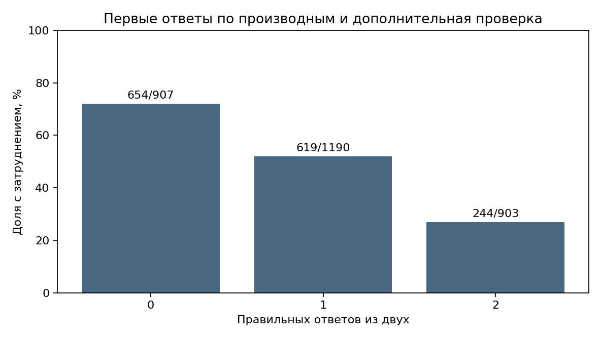
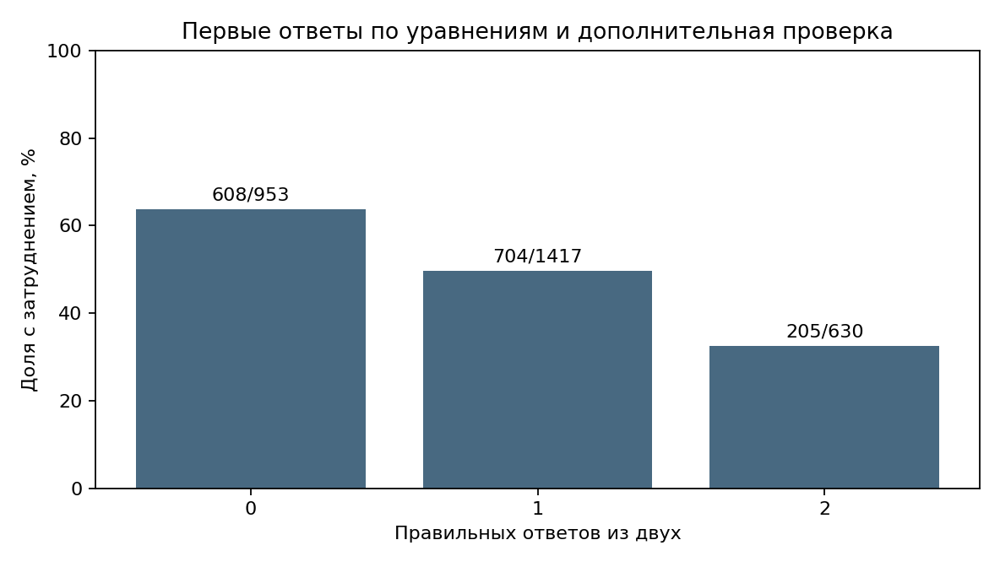

# Промежуточная аттестация: RemI AI

## 1. Выбранная база и задача

RemI AI помогает студенту найти темы, которые стоит повторить при изучении нового материала. Например, студент затрудняется с дифференциальными уравнениями. Система может задать несколько вопросов по уравнениям и производным, а затем предложить дополнительно проверить производные.

В базе PostgreSQL проекта для учебного примера созданы **3000 вымышленных студентов** и их диагностические сессии. Для каждой сессии смоделированы четыре начальных ответа и три ответа дополнительной проверки. Всего получено 21 000 учебных ответов.

**Ограничение:** ответы созданы программой, а связь между первыми и дополнительными ответами заложена в способ их моделирования. Эти данные показывают порядок анализа, но не описывают поведение реальных студентов и не доказывают эффективность приложения. Ответы сохранены в отдельной учебной таблице; настоящая диагностика приложением не проводилась.

## 2. Бизнес-задача и задача машинного обучения

Бизнес-задача — помочь студенту определить базовую тему, которую стоит проверить и, при необходимости, повторить.

Задача машинного обучения — по первым четырём ответам предположить, покажет ли дополнительная проверка затруднение с производными. Возможны два результата — да или нет, поэтому это задача классификации. Модель в работе не обучалась: подготовлены данные, выполнен анализ и сформулированы гипотезы.

## 3. Целевая переменная и признаки

Признаки, доступные до дополнительной проверки:

- число правильных ответов на два начальных вопроса по уравнениям;
- число правильных ответов на два начальных вопроса по производным.

Целевая переменная рассчитывается по трём **отдельным** вопросам дополнительной проверки производных. В учебном примере значение `1` означает, что правильных ответов не больше одного; `0` — что правильных ответов два или три. Это условный порог, а не утверждённый критерий освоения темы. Сами дополнительные ответы нельзя использовать как входные признаки: в момент прогноза они ещё неизвестны.

## 4. Представление и выгрузка

В PostgreSQL создано представление `attestation_demo_3000.diagnostic_features`. Оно объединяет учебные сессии с ответами, считает результаты начальных вопросов и дополнительной проверки, а затем рассчитывает целевую переменную. Полный запрос находится в [postgres_view.sql](postgres_view.sql).

Результат представления выгружен в [postgres_export.csv](postgres_export.csv). Каждая строка соответствует одной учебной сессии. Поле `session_id` в этой выгрузке содержит учебный номер участника, а не идентификатор сессии в основной таблице.

## 5. Анализ и очистка

- В выгрузке 3000 строк: 12 000 начальных ответов и 9000 ответов дополнительной проверки.
- По учебному правилу затруднение на дополнительной проверке отмечено в 1517 сессиях.
- Пропусков, повторов учебного номера и значений за допустимыми границами не обнаружено. После проверки сохранились все 3000 строк.
- Крайние допустимые результаты, например ноль правильных ответов из двух, сохраняются: это возможный результат, а не обязательно ошибка.

Проверенная таблица находится в [cleaned.csv](cleaned.csv), расчёты и построение графиков — в [analyse_postgres.py](analyse_postgres.py).

## 6. Графики и гипотезы

**Гипотеза 1.** Чем меньше правильных начальных ответов по производным, тем чаще дополнительная проверка покажет затруднение. На учебных данных в группах с 0, 1 и 2 правильными начальными ответами затруднение отмечено соответственно в 654 из 907, 619 из 1190 и 244 из 903 сессий.

**Гипотеза 2.** Меньшее число правильных ответов по уравнениям тоже может сопровождаться затруднением с производными. В группах с 0, 1 и 2 правильными ответами это 608 из 953, 704 из 1417 и 205 из 630 сессий.

В учебном примере доля затруднений уменьшается при увеличении числа правильных начальных ответов. Эта связь заложена в моделирование, поэтому по ней нельзя делать выводы о настоящих людях. В реальной системе результат первых ответов может стать поводом задать дополнительные вопросы, но не окончательным диагнозом.

## 7. Файлы и воспроизведение

- [Отчёт в PDF](Аттестация_RemI_диагностика.pdf).
- [Архив со всеми файлами](Аттестация_RemI_3000.zip).
- [SQL для учебного набора](загрузка_в_Remi_AI.sql): набор уже создан в базе; повторный запуск остановится, если набор существует.
- [Выгрузка из PostgreSQL](postgres_export.csv) и [очищенная таблица](cleaned.csv).
- [Код анализа и графиков](analyse_postgres.py): для запуска нужны Python, pandas и matplotlib. Команда `python analyse_postgres.py` читает сохранённую выгрузку и пересоздаёт очищенную таблицу, расчёты и графики; к PostgreSQL она не подключается.

Для исследования на реальных данных нужны проверенные вопросы и ответы, согласованные критерии и последующая проверка на новых студентах. Чтобы выяснить, помогли ли рекомендации, потребуется отдельная проверка после работы с материалами.
